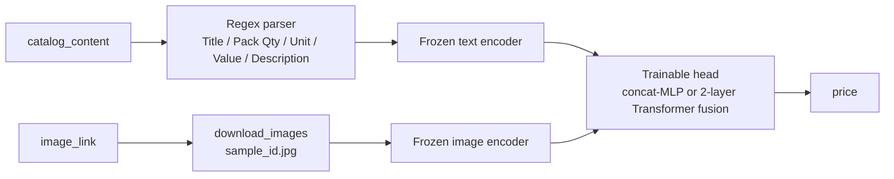

# Multimodal Item Price Predictor

Solution code for the **Amazon ML Challenge 2025: Smart Product Pricing**. The task is to predict the price of a product
from its catalog text (title, description, item pack quantity) and its product image. There are 75k labelled training
products and 75k test products, and submissions are scored with SMAPE.
The approach parses the free-text catalog entry into a structured prompt and pairs it with the product image. It then
trains lightweight regression and fusion heads on top of **frozen pretrained vision and language encoders**. The
encoders range from CLIP and ViT + RoBERTa dual encoders up to EVA-02 + DeBERTa-v3 with a Transformer fusion head. A
separate variant puts a regression head on a 4-bit **SmolVLM** vision-language model.

<!-- TODO(user): add team name / teammates (and your role) if this was a team entry -->

The original challenge brief is in [`docs/problem_statement.md`](docs/problem_statement.md).

## Results

<!-- TODO(user): add leaderboard SMAPE / rank -->
<!-- TODO(user): name the model/checkpoint that produced the submitted test_out.csv -->

| Evaluation | SMAPE (lower is better) |
|---|---|
| Public leaderboard (25k test samples) | _to be added_ |
| Final leaderboard (full 75k test set) / rank | _to be added_ |

The repository has no logged validation scores. The training scripts only show a running per-batch training SMAPE in the
progress bar. [`src/smape.py`](src/smape.py) implements the challenge metric so you can score any prediction file.

Data facts recorded in the repo:

- 74,999 of the 75,000 training images downloaded successfully; one image URL returned HTTP 404
  ([`src/example.ipynb`](src/example.ipynb) output). Every `training_dataset_*.jsonl` therefore has 74,999 rows.
- Training prices are heavily right-skewed: the median is 14.00, the mean is 23.65 and the maximum is 2,796
  (from `dataset/train.csv`).

## Approach



### 1. Feature extraction from catalog text

`create_vlm_prompt()` (shared by all scripts) uses regular expressions to pull these fields out of the raw
`catalog_content`:

- **title**: the `Item Name:` field.
- **item pack quantity**: `Item Pack Quantity`, `IPQ`, `Pack of N` or `N Count`.
- **unit** and **value/size**: the `Unit:` and `Value:` / `Size:` fields.

What remains becomes the description. The fields are combined into one normalised prompt, for example
`Title: … Pack Quantity: 6. Unit: Fl Oz. Value: 72.0. Description: …`, so pack size and unit are stated explicitly
instead of being buried in free text. Each run caches its prompts once as `{id, image_path, prompt, price}` JSONL.

### 2. Models

All backbones stay **frozen**; only the head is trained. Every script uses bfloat16, AdamW with a cosine-annealing
schedule, gradient accumulation, per-epoch checkpoints and automatic resume. Corrupt or truncated images are skipped by
falling back to the next sample.

| Script | Image encoder | Text encoder | Trainable head | Loss | Epochs | LR | Batch × accum |
|---|---|---|---|---|---|---|---|
| `clip.py` | CLIP ViT-B/16 | CLIP text | concat → MLP | MSE | 10 | 1e-4 | 32 × 2 |
| `cliplarge.py` | CLIP ViT-L/14 | CLIP text | Transformer fusion | MSE | 10 | 5e-5 | 16 × 4 |
| `vitdistil.py` | ViT-B/16 (IN-21k) | DistilBERT | concat → MLP | MSE | 10 | 1e-4 | 48 × 2 |
| `vitroberta.py` | ViT-B/16 (IN-21k) | RoBERTa-base | concat → MLP | L1 | 10 | 1e-4 | 32 × 2 |
| `vitrobertalarge.py` | ViT-L/16 | RoBERTa-large | Transformer fusion | MSE | 10 | 5e-5 | 16 × 4 |
| `swindebert.py` | Swin-L (384, IN-22k) | DeBERTa-v3-large | projection + Transformer fusion | MSE | 5 | 5e-5 | 16 × 4 |
| `evadebert.py` | EVA-02-L/14 (timm, MIM IN-22k) | DeBERTa-v3-large | projection + Transformer fusion | MSE | 5 | 5e-5 | 16 × 8 |
| `finalsmolvlm.py` | SmolVLM-500M-Instruct (4-bit) | (same model) | last-token hidden state → MLP | MSE | 5 | 5e-5 | 16 × 2 |
| `smol256.py` | SmolVLM-256M-Instruct (4-bit) | (same model) | last-token hidden state → MLP | MSE | 5 | 5e-5 | 20 × 2 |
| `smolvlm.py` | SmolVLM-500M-Instruct (4-bit) | (same model) | MLP, 90/10 train/val split, best-val checkpoint | MSE | 5 | 5e-5 | 4 × 1 |

How the heads work:

- **Concat-MLP head:** concatenates the pooled image and text embeddings, then applies Linear → GELU → Dropout(0.3) → Linear.
- **Transformer fusion head:** treats the image and text embeddings as a two-token sequence. The Swin/EVA-02 + DeBERTa
  variants first project both embeddings to 1024-d. A 2-layer `nn.TransformerEncoder` (GELU, dropout 0.2) lets the two
  modalities attend to each other. The fused first token then goes through LayerNorm → MLP to produce the price.
- **SmolVLM head:** the image and the prompt `"<image>\nPredict the price for the item.\n{prompt}"` go through the
  quantised VLM. The final-layer hidden state of the last token feeds an MLP regressor.
  [`src/embeddings.py`](src/embeddings.py) can cache these embeddings for SmolVLM-256M in advance, so the head trains
  without re-running the VLM.

Every backbone is far below the challenge's 8B-parameter limit.

### 3. Inference

The `predict*.py` scripts rebuild the same prompt and load the trained head on top of the frozen backbone. They write
a `sample_id,price` CSV in the format the challenge asks for.

| Training script | Inference script |
|---|---|
| `clip.py` | `predictclip.py` |
| `vitdistil.py` | `predictvitdistil.py` (`--checkpoint` is a directory; the latest `.pth` is used) |
| `vitroberta.py` | `predictvitroberta.py` |
| `vitrobertalarge.py` | `predictvitrobertalarge.py` |
| EVA-02 + DeBERTa fusion head | `predeva.py` (`predictevagput.py` splits inference across several GPUs) |
| `smolvlm.py` / `smol256.py` / `finalsmolvlm.py` | `predict.py` (pass `--model_name` for the 256M model) |

## Tech stack

Python, PyTorch, Hugging Face Transformers (CLIP, ViT, RoBERTa, DistilBERT, DeBERTa-v3, Swin, SmolVLM), timm (EVA-02),
bitsandbytes (4-bit quantisation), Accelerate, Pillow, pandas, NumPy, scikit-learn, tqdm. Training ran on a multi-GPU
CUDA server in bfloat16.

## Repository structure

```
.
├── dataset/                    # challenge CSVs: train.csv / test.csv (75k rows each), sample_test*.csv,
│                               # and a 10k training subset used for quick checks
├── docs/
│   ├── problem_statement.md    # original challenge brief
│   └── Documentation_template.md  # organisers' write-up template
├── src/
│   ├── utils.py                # parallel image downloader (starter kit)
│   ├── example.ipynb           # loads the CSVs and downloads images
│   ├── clip.py, cliplarge.py   # CLIP dual-encoder training
│   ├── vitdistil.py, vitroberta.py, vitrobertalarge.py
│   ├── swindebert.py, evadebert.py          # large backbones + fusion head
│   ├── smolvlm.py, smol256.py, finalsmolvlm.py  # SmolVLM + regression head
│   ├── embeddings.py           # cache SmolVLM-256M embeddings
│   ├── predict*.py, predeva.py # inference -> sample_id,price CSV
│   ├── smape.py                # challenge metric
│   └── *.csv, *.jsonl          # generated prompt datasets and prediction files
├── sample_code.py              # starter-kit random baseline (output-format reference)
├── requirements.txt
└── LICENSE
```

## How to run

**1. Set up the environment.** Training needs a CUDA GPU with bfloat16 support. The SmolVLM scripts also need
`bitsandbytes` for 4-bit loading.

```bash
git clone https://github.com/yashsinha1702/Multimodal-Item-Price-Predictor.git
cd Multimodal-Item-Price-Predictor
python -m venv .venv && source .venv/bin/activate
pip install -r requirements.txt
```

**2. Get the data.** Put the challenge CSVs in `dataset/`, then download the product images. Each image is saved as
`<sample_id>.jpg`:

```bash
cd src
python -c "
import pandas as pd
from utils import download_images
for split, out in [('train', '../images'), ('test', '../test/images')]:
    df = pd.read_csv(f'../dataset/{split}.csv')
    download_images(df['image_link'], out, df['sample_id'])
"
```

**3. Train a model.** Each training script starts with a `CONFIG` dict. Set `csv_file_path`, `image_directory` and
`device` for your machine; they currently point at the original training server. Then run the script from `src/`:

```bash
python cliplarge.py      # builds training_dataset_clip_large.jsonl, then trains the fusion head
python finalsmolvlm.py   # SmolVLM-500M regression head -> checkpoints/smolvlm_epoch_N.pth
```

**4. Predict and score.**

```bash
python predictvitrobertalarge.py \
    --checkpoint vit_roberta_fusion_checkpoints/vit_roberta_fusion_epoch_10.pth \
    --input_csv ../dataset/test.csv --image_dir ../test/images --output_csv test_out.csv

python predict.py --checkpoint checkpoints/smolvlm_epoch_5.pth \
    --input_csv ../dataset/test.csv --image_dir ../test/images --output_csv test_out.csv

python smape.py ground_truth.csv predictions.csv   # both need a `price` column, rows in the same order
```

> **Note:** This is research code written under competition time limits. Paths and GPU ids are hard-coded in each
> script. A few training/inference pairs also drifted apart during iteration. For example, `cliplarge.py` and
> `evadebert.py` define Transformer fusion heads, but `predictcliplarge.py` and `predictevadebert.py` still load the
> earlier concat-MLP heads. Before running inference, check that the head class matches the checkpoint.

## License

The code is released under the [MIT License](LICENSE). The challenge dataset and the starter-kit files
(`sample_code.py`, `src/utils.py`, `docs/`) belong to the challenge organisers.
